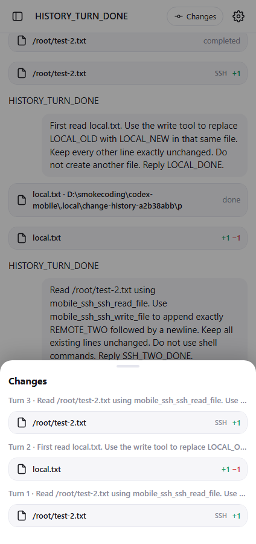
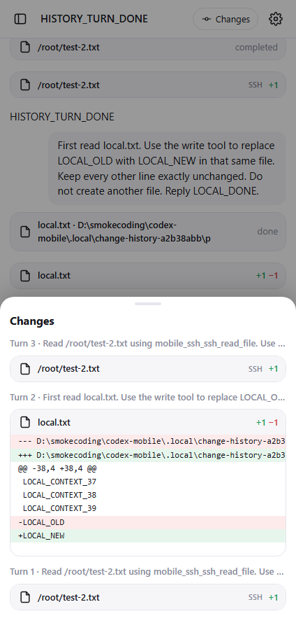

# Пункт 1: история изменений агента

## Настоящий OpenCode 1.19.3: Git и snapshots

`tests/snapshot_probe.py` сделал реальные правки через AgentRouter/gpt-5.6-sol в двух изолированных проектах.

| Проект | Файл изменён | step-start snapshot | patch-part | `/session/{id}/diff` |
| --- | --- | --- | --- | --- |
| Без Git | да | нет | 0 | `[]` |
| С Git и начальным коммитом | да | есть | 1 | `[]` |

Git необходим для snapshots, но этого недостаточно для непустого session/diff в проверенном окружении. Android `stageBinDir()` создаёт заглушку `git` с `exit 128`; запись имени git в логе не является рабочим Git-probe.

## Реализация

Новый проект получает настоящий `.git` через JGit и локальные `user.name/email`. Начальный коммит пустой: пользовательские файлы не добавляются. Для уже существующего репозитория конфигурация, HEAD и индекс сохраняются.

`refs/codex/changes/<sessionID>` хранит один коммит на ход пользователя. В его дереве только `turn.json` и файлы патчей. Содержимое файлов целиком не зеркалируется. Патчи содержат изменённые строки и до трёх строк контекста; Git log и чтение blob из дерева коммита служат источником Changes. Рабочая ветка не переключается, Git hooks и signing не запускаются.

Источники: `metadata.files[].patch` для apply_patch, `metadata.diff` для edit, подтверждённый `permission.metadata.diff` для write, JSON-результат `ssh_write_file` для SSH. Ошибочные вызовы не записываются. Привязка к ходу — `assistant.parentID`. Повторное чтение сессии не создаёт новые коммиты.

JS-мост принимает фиксированные операции historyRegister/Hint/Record/List/Show. Локальный путь канонизируется и проверяется по зарегистрированным проектам. Удалённый путь — метаданные, его не открывают на устройстве. Произвольной команды Git или shell из WebView нет.

У `PATCH /session` обнаружена добавочная семантика permission: прежние deny остаются. При SSH → Local восстанавливаются настройки проекта, агента и исходной сессии. Для локальной записи требуется подтверждение, позволяющее сохранить исходный diff; запреты пользователя сохраняются.

## Проверки

`python tests/change_history.py`: **7/7 PASS**, `pageErrors: []`. Сервер OpenCode, SSH/SFTP, Java SSH-реализация и Kotlin/JGit настоящие. Локальный OpenAI-совместимый провайдер детерминированно выбирает инструменты; сам файлов не меняет.

- SSH: к существующему файлу добавлена строка, коммит `+1`.
- Local: реальный write заменил одну строку, коммит `+1 −1`, без снимка всего файла.
- Второй SSH-ход: ещё одна строка, коммит `+1`, первая добавленная строка не записана повторно.
- Native Git CLI подтвердил три коммита с одними патчами/метаданными, прежние HEAD и индекс, неизменный пользовательский файл.
- Незарегистрированная папка, traversal и чужой commit отклонены.
- Changes показывает оба источника; строки свёрнуты, раскрытие внутри шторки. История и счётчики сохраняются после reload, дубли не появляются.

`python tests/mobile_features.py`: **9/9 PASS**, `pageErrors: []`. Реальный AgentRouter, пароль и зашифрованный Ed25519 SSH-ключ, подтверждения, потоковый вывод, удалённое чтение/запись, вложения, темы/шрифт, проекты и websearch.

Дополнительный Playwright-прогон против настоящего сервера проверил компактные однострочные заголовки ходов и раскрытие сохранённого Git-патча.

## Разбор исходного примера на Pixel

Существующий сервер телефона 1.19.3 прочитан через ADB/AuthProxy без новых промптов и изменения удалённых файлов. Порядок tool-parts: `ssh_read_file /root/test.txt` успешно, 27 символов; `ssh_read_file /root/test-2.txt` — error; `ssh_write_file /root/test-2.txt` — 15 символов; чтение этого файла — 15; следующая запись — 34. Пустой файл в этой последовательности не создавался. Типы карточек и подробности ошибок относятся к пункту 5.

## Проверить на телефоне после нового APK

- Автоматическое создание Git для старого зарегистрированного проекта и новых папок, включая доступ через SAF.
- В одной сессии: SSH-правка → Local-правка → Changes, обе строки и точные `+N/−N`.
- Следующее добавление строки отображает `+1`, затем история остаётся после перезапуска приложения.
- Существующие пользовательские коммиты, индекс и настройки Git сохранены.

Пункты 2–7 не выполнялись; установка нового APK на Pixel в этом пункте не выполнялась.
