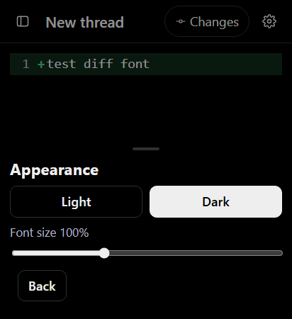
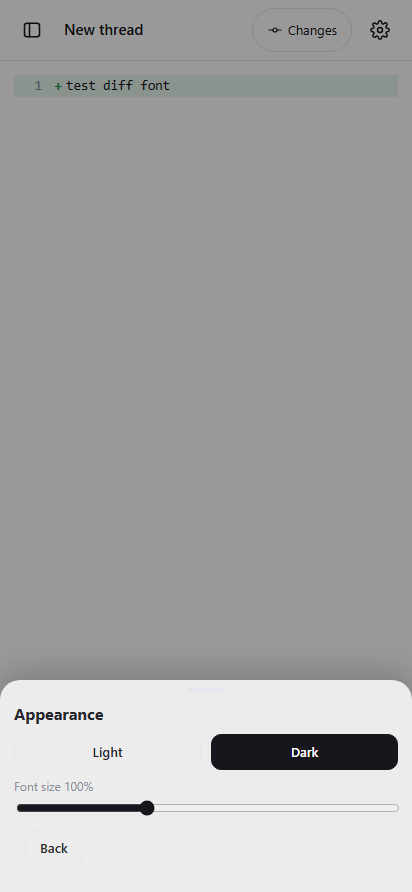

# Пункт 6: Композер и чипы

## Проблема

1. Зоны нажатия некоторых кнопок и чипов были меньше рекомендуемого стандарта доступности 44px (кнопка `+` была 30×30px, кнопка отправки 36×36px, чипы имели малые вертикальные отступы).
2. Подпись активного SSH-подключения выводилась без префикса «SSH:», что сбивало с толку (например, `2KopeikiAeza` вместо `SSH: 2KopeikiAeza`).
3. В тёмной теме вторичный текст (`--mut: #999`) имел недостаточную контрастность на глубоком чёрном фоне.
4. Моноширинный шрифт диффов (12px) был мелковат для комфортного чтения на экранах смартфонов.
5. Последнее сообщение ленты вплотную упиралось в композер без мягкого визуального перехода.

---

## Реализация

1. **Зоны нажатия минимум 44px**:
   - Кнопка вложений `#plus`: `min-width: 44px; min-height: 44px;` с центрированием иконки.
   - Кнопка отправки `#send`: `min-width: 44px; min-height: 44px;` (круглая кнопка 44×44px).
   - Чипы модели (`#cModel`) и усилия (`#cEff`): `min-height: 44px; padding: 6px 8px; border-radius: 10px;`.
   - Нижние чипы (`#cEnv`, `#cPerm`, `#cSearch`): `min-height: 44px; padding: 6px 12px;`.
   - Кнопки заголовка (`#menu`, `#gear`, `#commit`): `min-width: 44px; min-height: 44px;`.

2. **Понятные подписи и иконки**:
   - При активном SSH-подключении чип окружения отображает иконку терминала и подпись:
     `SSH: <имя_подключения>` (например, `SSH: 2KopeikiAeza`).
   - При локальном режиме отображается иконка устройства и подпись `Local`.
   - Чип агента отображает: `Agent: build` / `Agent: plan`.
   - Чип поиска снабжён иконкой лупы: `Web search`.

3. **Нижний отступ ленты и мягкий градиент**:
   - В ленте (`main`) увеличен нижний отступ до `padding-bottom: 28px`.
   - В композере (`footer`) добавлен мягкий градиентный фон и псевдоэлемент `footer::before` (высота 18px), создающий плавное затухание сообщений ленты над композером без резкой границы.
   - Значения цвета адаптируются к теме через `--bg-rgb` (белый для светлой темы, чёрный для тёмной).

4. **Контрастность вторичного текста в тёмной теме**:
   - В тёмной теме значение переменной `--mut` повышено до `#b0b3c2` (контрастность >7.5:1 к `#000000`).
   - Мелкие подписи, даты, бейджи и счётчики стали чёткими и легко читаемыми на OLED-экране.

5. **Крупнее моно-шрифт диффов**:
   - Размер шрифта строк диффа (`.diff-line`, `.dl`) увеличен до `13.5px` (умножается на `--font-scale`).
   - Номера строк и знаки `+`/`−` стали заметно крупнее и разборчивее.

6. **Адаптивность к узким экранам, масштабу шрифта и клавиатуре**:
   - Чипы в `.crow` снабжены `min-width: 0; max-width: calc(50vw - 56px);` с обрезкой текста троеточием (`text-overflow: ellipsis`), что предотвращает выталкивание кнопки отправки даже на узких экранах 320px и 360px.
   - При увеличении масштаба шрифта (до 140%) интерфейс сохраняет пропорции и доступность зон тапа.
   - При открытой экранной клавиатуре (высота viewport 450px) композер остаётся зафиксированным над клавиатурой и сохраняет зоны нажатия 44px.

---

## Проверки на настоящем сервере

Запуск `python tests/composer_chips_proof.py`: **8/8 PASS**, `pageErrors: []`.

1. `all_touch_targets_min_44px`: подтверждены размеры `#plus` (44×44), `#send` (44×44), `#cModel` (≥44), `#cEff` (≥44), `#cEnv` (≥44), `#cPerm` (≥44), `#menu` (44×44), `#gear` (44×44), `#commit` (≥44).
2. `clear_ssh_connection_label_and_icon`: в SSH-режиме отображается `SSH: 2KopeikiAeza` с иконкой терминала, в локальном — `Local`.
3. `feed_bottom_spacing_and_gradient`: нижний отступ ленты равен 28px, подтверждён градиентный фон `footer`.
4. `dark_theme_contrast_improved`: в тёмной теме цвет `--mut` равен `#b0b3c2`.
5. `larger_diff_monospace_font`: размер шрифта строк диффа равен 13.5px.
6. `narrow_screen_composer_fit_360_320`: проверены экраны 360px и 320px — кнопка `#send` остаётся в пределах экрана и полностью кликабельна.
7. `increased_font_scale_accessible`: при масштабе 140% все зоны нажатия сохраняются ≥44px.
8. `composer_screenshots_saved`: доказательные скриншоты сохранены в:
   - `tests/evidence/composer-chips-dark-keyboard.png` (тёмная тема, бейдж SSH, открытая клавиатура);
   - `tests/evidence/composer-chips-light.png` (светлая тема, композер, чипы).

## Регрессионные тесты

- `python tests/feed_cards_proof.py`: **6/6 PASS**
- `python tests/webview_layout_proof.py`: **8/8 PASS**
- `python tests/sidebar_proof.py`: **7/7 PASS**
- `python tests/reasoning_effort_proof.py`: **7/7 PASS**
- `python tests/change_history.py`: **7/7 PASS**
- `python tests/mobile_features.py`: **9/9 PASS**

## Проверить на телефоне Pixel 6

1. Зоны нажатия кнопки `+`, кнопки отправки и всех чипов стали крупнее (44px), удобно нажимаются пальцем.
2. При подключённом SSH на чипе явно написано `SSH: имя_сервера` с иконкой терминала.
3. В тёмной теме мелкие подписи и даты стали значительно контрастнее и легче читаются.
4. Шрифт в строках изменений (диффах) стал крупнее.
5. Лента плавно растворяется над композером через мягкий градиент.
