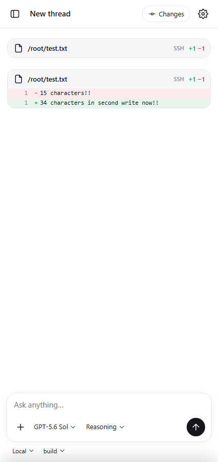

# Пункт 5: Лента и карточки

## Проблемы

1. **Призрачный дифф (Ghost Diff)**: после второго изменения файла карточка диффа первой записи повторно появлялась внизу ленты. Причина: сопоставление удалённых запусков (`remoteRuns`) шло по одному лишь пути файла без учёта `runID` на развёрнутом массиве, из-за чего первый ход захватывал последний запуск, а старый запуск оставался «неподхваченным» и принудительно рисовался в самом конце ленты.
2. **Смешение типов операций**: чтение файла отображалось как создание или пустая запись; ошибка чтения скрывала текст сбоя; количество прочитанных/записанных символов не выводилось.
3. **Заголовки команд и хост**: заголовок команды вытеснялся именем подключения, а статус выполнения не был унифицирован.
4. **Небезопасный или отсутствующий Markdown**: сырой Markdown выводился как обычный текст, не было поддержки таблиц, списков, блоков кода с копированием, а опасные URL не фильтровались.
5. **Диффы**: служебные строки `---/+++/@@` засоряли видимый текст при раскрытии изменений, не было номеров строк.

---

## Реализация

1. **Устранение призрачного диффа**:
   - В `RemoteSsh.java` метод `writeFile` теперь явно возвращает `runID` в JSON-ответе инструмента (`patch.put("runID", run)`).
   - В `codex.html` введена коллекция `claimedRuns = new Set()`: каждый запуск связывается со своим конкретным tool-part по `runID` либо в прямом хронологическом порядке без повторных захватов.
   - В конец ленты выводятся только активные (`r.status === 'running'`) фоновые команды, которые ещё не завершились в tool-part. Завершённые правки файлов никогда повторно не дублируются внизу.
   - Тест `tests/feed_cards_proof.py` воспроизвёл два последовательных изменения одного SSH-файла: в ленте отображаются ровно 2 карточки, призрачный дифф полностью устранён.

2. **Чёткое разделение чтения, записи и команд**:
   - `read` / `ssh_read_file`: заголовок «Read <файл>», иконка файла/книги, количество символов (`X chars`). Свёрнуто в аккуратную компактную строку, раскрывается по нажатию.
   - `write` / `ssh_write_file`: заголовок «Write <файл>», иконка редактирования, счётчики `+N −N`.
   - `edit` / `apply_patch`: заголовок «Edit <файл>», счётчики `+N −N`.
   - `bash` / `ssh_exec`: заголовком карточки является сама команда/действие; SSH-хост вынесен в небольшой бейдж `.ssh-badge`.

3. **Ошибки инструментов**:
   - Любая ошибка инструмента (`isErr`) рендерится как явная карточка с текстом ошибки (`ENOENT...`, `Permission denied` и др.) в блоке `.er-body` со статусом `Failed`. Ошибка не скрывается внутри свёрнутых аккордеонов.

4. **Длинный вывод и «Показать больше»**:
   - Длинный вывод команд (>8 строк или >400 символов) ограничивается высотой `.collapsed-pre` с кнопкой «Show more» («Показать больше»).
   - Нажатие плавно снимает ограничение и меняет кнопку на «Show less». Горизонтальный скролл строк сохранён.

5. **Очистка диффов и номера строк**:
   - При раскрытии изменений служебные строки `---`, `+++`, `@@ ... @@` удаляются из видимого текста.
   - Добавлены номера строк (`.diff-num`), индикаторы знака `+`/`−` (`.diff-sign`) и подсветка строк зелёным/красным.

6. **Единый статус выполнения**:
   - Все карточки инструментов и удалённых запусков используют единую систему статусов:
     - В процессе: `<span class="m"><span class="spin"></span>Running</span>`
     - Успешно: `<span class="m ok">Completed</span>`
     - Ошибка: `<span class="m er">Failed</span>`

7. **Безопасный Markdown (без внешних библиотек и CDN)**:
   - Собственный парсер `renderMarkdown()`:
     - HTML-экранирование (`esc()`) на первом шаге.
     - Заголовки `#`, `##`, `###`.
     - Жирный `**` / `__`, курсив `*` / `_`, инлайн-код `` `code` ``.
     - Блоки кода ` ```lang ` с заголовком языка и рабочей кнопкой «Copy» (копирует в буфер обмена с индикацией «Copied!»).
     - Маркированные (`<ul><li>`) и нумерованные (`<ol><li>`) списки.
     - Markdown-таблицы с адаптивным горизонтальным скроллом.
     - Ссылки: разрешены только схемы `https://` и `http://` с `target="_blank" rel="noopener noreferrer"`. Ссылки со схемами `javascript:`, `data:`, `file:` нейтрализуются в безопасный текст.

---

## Проверки на настоящем сервере

Запуск `python tests/feed_cards_proof.py`: **6/6 PASS**, `pageErrors: []`.

1. `safe_markdown_tables_lists_code_blocks`:
   - Заголовки, жирный, курсив, инлайн-код, списки, таблицы и блоки кода с кнопкой Copy работают корректно.
   - Инъекции `<script>` и `` экранированы в безопасный текст.
   - Опасный `javascript:` URL нейтрализован.
2. `tool_error_displays_exact_message`:
   - Ошибка инструмента `ENOENT: no such file or directory...` полностью отображается со статусом `Failed`.
3. `clean_diff_line_numbers_without_git_headers`:
   - Строки `---`, `+++`, `@@` отсутствуют в видимом DOM.
   - Присутствуют номера строк и знаки изменений.
4. `collapsible_output_show_more_toggle`:
   - Команда является заголовком, хост — бейджем.
   - Длинный вывод сжат кнопкой «Show more», по клику раскрывается на полную высоту и переключается на «Show less».
5. `two_consecutive_ssh_edits_without_ghost_diff`:
   - Воспроизведены два последовательных изменения одного SSH-файла (`/root/test.txt`).
   - В ленте отображаются ровно 2 карточки изменений. Лишняя (призрачная) карточка внизу отсутствует.
6. `feed_cards_proof_screenshot_saved`: скриншот сохранён в `tests/evidence/feed-cards-and-diff-proof.png`.



## Регрессионные тесты

- `python tests/webview_layout_proof.py`: **8/8 PASS**
- `python tests/sidebar_proof.py`: **7/7 PASS**
- `python tests/reasoning_effort_proof.py`: **7/7 PASS**
- `python tests/change_history.py`: **7/7 PASS**
- `python tests/mobile_features.py`: **9/9 PASS**

## Проверить на телефоне Pixel 6

1. В ответах модели отображается красивый Markdown: списки, заголовки, таблицы, блоки кода с кнопкой копирования («Copy» -> «Copied!»).
2. Вызовы инструментов имеют чёткие понятные названия: «Read file...» (с количеством символов), «Write file...» (со счётчиками), заголовок команды отображает команду, а SSH-сервер — аккуратным бейджем.
3. Ошибки чтения/выполнения выводятся прямо в карточке с текстом ошибки и статусом `Failed`.
4. Длинный вывод скрывается за кнопкой «Show more».
5. При двух последовательных правках одного SSH-файла внизу ленты не появляется дублирующийся старый дифф.
6. При раскрытии диффа видны номера строк, а заголовки `---/+++/@@` не засоряют текст.
