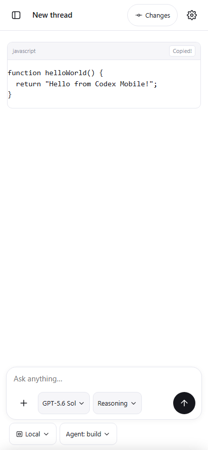

# Пункт 7: Финальные мелочи

## Реализация

1. **Скелетоны загрузки**:
   - `renderSessionSkeleton()`: при открытии любого треда (`openSession`) лента мгновенно отображает аккуратный скелетон диалога (мерцающее сообщение пользователя справа и 3 строки ответа ассистента слева), устраняя белый экран до ответа сервера.
   - В шторке изменений `Changes`: во время загрузки патча выводится скелетон `.skeleton-row` вместо статического текста.
   - В боковой панели: скелетон загрузки сессий папки отображает мерцающие строки `.sk-line`.

2. **Понятные пустые состояния (Empty states)**:
   - В шторке `Changes`: если тред ещё не выбран, отображается понятный блок с иконкой «No thread selected» («Open a thread to view its changes»); если правок ещё не было — «No changes yet».
   - В шторке SSH-подключений: если подключений нет, отображается блок с иконкой терминала «No SSH connections yet» и подсказкой о добавлении сервера.
   - В папке боковой панели: если тредов в папке нет, отображается аккуратный блок «No threads yet» с быстрой кнопкой создания треда `+ New thread`.

3. **Закрытие шторки свайпом вниз (Swipe-to-dismiss)**:
   - Реализован тактильный жест свайпа вниз для нижней шторки (`#sheet`):
     - Отслеживаются касания за верхнюю ручку `.grab` и свайп вниз при `scrollTop <= 5`.
     - При протяжке вниз шторка следует за пальцем в реальном времени (`translateY`), а затемнение `#dim` плавно рассеивается.
     - При свайпе более 80px вниз шторка закрывается (`closeAll()`).
     - При меньшем смещении шторка плавно возвращается в исходное открытое положение.
     - Работает как для сенсорного ввода на Android, так и для drag-жеста мыши на `.grab`.

4. **Надёжное копирование блоков кода**:
   - Кнопка «Copy» в шапке каждого блока кода копирует чистый код в буфер обмена.
   - Поддерживает `navigator.clipboard.writeText` с автоматическим резервным механизмом `document.execCommand('copy')` через временный элемент `textarea` на случай строгих политик безопасности WebView.
   - При успешном копировании кнопка на 1.5 секунды меняет текст на «Copied!» и подсвечивается акцентным зелёным цветом (`.copy-btn.copied`).

---

## Проверки на настоящем сервере

Запуск `python tests/final_polish_proof.py`: **4/4 PASS**, `pageErrors: []`.

1. `session_loading_skeletons`: скелетон сессии генерирует правильную разметку сообщений пользователя и ассистента с мерцающими линиями `.sk-line`.
2. `informative_empty_states_verified`: пустые состояния проверены для шторки Changes, шторки SSH и пустой папки проектов.
3. `swipe_to_dismiss_bottom_sheet`:
   - Малый сдвиг (35px) оставляет шторку открытой.
   - Свайп вниз (150px) плавно закрывает шторку.
4. `code_block_copy_with_feedback`: клик по кнопке Copy копирует код, меняет текст на «Copied!» и добавляет класс `.copied`.
5. `final-polish-code-copy.png`: скриншот сохранён в `tests/evidence/final-polish-code-copy.png`.

## Регрессионные тесты

- `python tests/composer_chips_proof.py`: **8/8 PASS**
- `python tests/feed_cards_proof.py`: **6/6 PASS**
- `python tests/webview_layout_proof.py`: **8/8 PASS**
- `python tests/sidebar_proof.py`: **7/7 PASS**
- `python tests/reasoning_effort_proof.py`: **7/7 PASS**
- `python tests/change_history.py`: **7/7 PASS**
- `python tests/mobile_features.py`: **9/9 PASS**

## Проверить на телефоне Pixel 6

1. При открытии треда на короткое время виден аккуратный скелетон диалога, сменяющийся сообщениями.
2. В блоках кода кнопка «Copy» копирует текст и подсвечивается «Copied!».
3. Любую шторку (настройки, выбор модели, Changes) можно закрыть свайпом вниз за верхнюю полоску-ручку.
4. В пустых состояниях (Changes без правок, список SSH без серверов) выводятся информативные экраны с подсказками.
