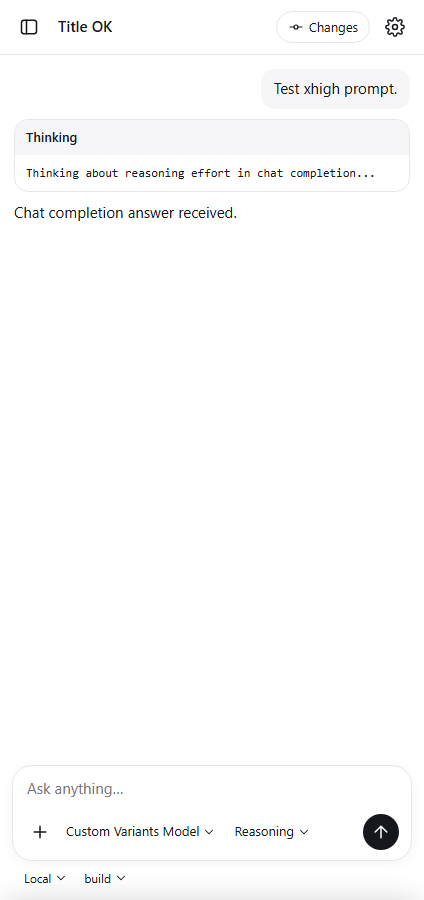

# Пункт 2: Reasoning effort всегда доступен и отправляется

## Проблема

Ранее чип Reasoning становился серым (`muted`), если у модели не были предварительно объявлены `variants`, а при нажатии шторка сообщала «This model does not offer reasoning controls». Кроме того, `body.variant` отправлялся только если выбранное значение уже присутствовало в объявленных variants модели.

## Реализация

1. **Доступность выбора усилия**:
   - Чип Reasoning всегда активен (класс `muted` убран), показывает текущее выбранное усилие (`None`, `Low`, `Medium`, `High`, `Very high`) либо `Reasoning` по умолчанию.
   - По нажатию на чип открывается шторка со значениями: `Default`, `None`, `Low`, `Medium`, `High`; а также `Very high` (`xhigh`), когда модель его поддерживает (по существующим variants, ID модели или каталогу OpenCode: семейство GPT-5/6, DeepSeek, Qwen, MiniMax, MiMo).

2. **Сохранение и отправка**:
   - Выбранное значение сохраняется раздельно для каждой пары `provider/model` в `localStorage` (`oc_efforts[provider/model]`).
   - Если у модели уже были объявлены собственные variants (например, `high`/`max`), они сохраняются и не затираются.
   - Если variants у модели отсутствуют, настройки `reasoningEffort` добавляются в конфигурацию модели через `PATCH /global/config` (без параметра `directory`, чтобы настройки провайдера сохранялись персистентно и не конфликтовали с локальными `config.json`). Аутентификационные ключи хранятся через `/auth` и не затрагиваются.
   - Выбранный variant гарантированно передаётся в `prompt_async` (`body.variant = eff`). OpenCode транслирует его в:
     - Chat Completions (`@ai-sdk/openai-compatible`): `body.reasoning_effort`.
     - Responses (`@ai-sdk/openai`): `body.reasoning.effort`.

3. **Отображение reasoning-parts / Thinking**:
   - Любые reasoning-parts от сервера отображаются в ленте в виде карточки `
` с заголовком `Thinking`.
   - При повторном рендере сохраняется состояние раскрытия деталей.
   - Потоковые дельты (`message.part.delta`) корректно сохраняют тип `reasoning` и накапливают текст.

## Доказательство (настоящий OpenCode 1.19.3 + фейковый провайдер)

Запуск `python tests/reasoning_effort_proof.py`: **6/6 PASS**, `pageErrors: []`.

1. **Chat Completions (`@ai-sdk/openai-compatible`)**:
   - Модель `chat-model` изначально без объявленных variants.
   - Через UI выбран уровень `High`.
   - Чип обновился на `High`.
   - Запрос к `prompt_async`: `variant = "high"`.
   - Тело запроса, дошедшего до провайдера на `/v1/chat/completions`:
     `reasoning_effort = "high"`.
   - В ленте отображена карточка Thinking: «Thinking about reasoning effort in chat completion...».

2. **Responses (`@ai-sdk/openai`)**:
   - Модель `resp-model` изначально без объявленных variants.
   - Через UI выбран уровень `Low`.
   - Чип обновился на `Low`.
   - Запрос к `prompt_async`: `variant = "low"`.
   - Тело запроса, дошедшего до провайдера на `/v1/responses`:
     `reasoning.effort = "low"`.
   - В ленте отображена карточка Thinking.

3. **Раздельное сохранение на пару provider/model и сохранение после reload**:
   - При переключении между моделями `fake-chat/chat-model` (`High`) и `fake-resp/resp-model` (`Low`) значения не сбиваются.
   - Перезагрузка страницы сохраняет выбранные уровни.

4. **Поддержка `xhigh`**:
   - Модель `deepseek-v4-flash` предлагает вариант `Very high`.
   - При выборе передаётся `variant = "xhigh"`, до провайдера доходит `reasoning_effort = "xhigh"`.

5. **Сохранение существующих variants**:
   - Для модели с предварительно объявленными variants (`high`, `max`) они сохранены и предложены в шторке.

6. **Отображение и раскрытие Thinking**:
   - Скриншот раскрытой карточки Thinking сохранён в `tests/evidence/reasoning-thinking-proof.png`.

## Регрессионные проверки

- `python tests/change_history.py`: **7/7 PASS**, `pageErrors: []`.
- `python tests/mobile_features.py`: **9/9 PASS**, `pageErrors: []`.

## Проверить на телефоне после нового APK

- На Pixel открыть шторку Reasoning для AgentRouter и других провайдеров: чип не серый, доступны опции none/low/medium/high (и xhigh).
- Выбрать усилие для модели A, переключиться на модель B и обратно — настройки сохраняются раздельно.
- Отправить промпт с включённым reasoning: в ленте появляется карточка Thinking, плавно раскрывается по нажатию.
