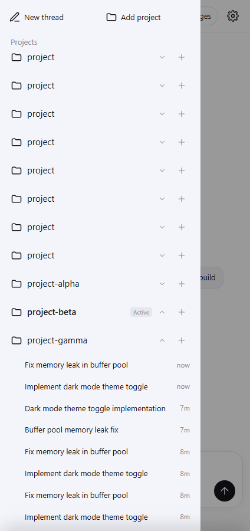

# Пункт 3: Боковая панель

## Диагностика автозаголовков и small_model в OpenCode 1.19.3 (только факты)

Анализ исходного кода и бинарного файла `opencode.exe` (1.19.3) показал точный механизм генерации заголовков и причину их отсутствия у кастомных провайдеров:

1. **Вызов генератора заголовка**:
   - При первом сообщении пользователя запускается фоновая подзадача специального агента `title` (`SessionPrompt.handleSubtask`).
   - Функция выбора модели для этой подзадачи — `Provider.getSmallModel(providerID)`:
     ```javascript
     if (w.small_model) {
       let R = gJ(w.small_model);
       return yield* j(R.providerID, R.modelID);
     }
     let L = (yield* t.get(H)).providers[B];
     if (!L) return;
     let N = B.startsWith("opencode") ? ["gpt-nano"] : B.startsWith("github-copilot") ? ["gpt-mini", ...VQ] : VQ;
     let P = FJ(Object.values(L.models), ...);
     for (let R of N) {
       let D = P.filter((c) => c.family === R);
       if (D[0]) return D[0];
     }
     return;
     ```
2. **Причина отсутствия автозаголовков у кастомных провайдеров**:
   - Если в конфигурации не задан параметр `small_model`, `getSmallModel` пытается сопоставить модели провайдера по жёстко закодированным семействам `family === "gpt-nano"` или `family === "gpt-mini"`.
   - У моделей любого кастомного провайдера (AgentRouter и др.) поле `family` всегда равно пустой строке `""` (`known.family || ""`).
   - Поэтому `getSmallModel` для кастомных провайдеров **всегда возвращает `undefined`**.
   - OpenCode в таком случае переключается на основную модель сессии:
     ```javascript
     let Ge = (yield* i.getSmallModel(t.providerID)) ?? (yield* i.getModel(t.providerID, t.modelID));
     ```
   - Запрос на генерацию заголовка отправляется в основную большую/рассуждающую модель (`gpt-5.6-sol`, `gpt-6.1-sol` и т.д.) без указания вариантов (`variant` не передаётся) с флагом `small: true`.
   - Если этот запрос отсекается таймаутом, падает с ошибкой провайдера или возвращает пустой стрим, OpenCode подавляет ошибку (`catchCause(() => s.logError("failed to generate title"))`) и заголовок сессии навсегда остаётся стандартным конструктором:
     `title: New session - ${new Date(d).toISOString()}`.

3. **Решение в клиенте**:
   - Если сессия имеет дефолтный заголовок (`isDefaultTitle(s.title)` — формат `New session - ...`, `Untitled`, `New thread`), клиент отображает начало первого пользовательского сообщения (до 50 символов).
   - При отправке первого сообщения в сессию чистый заголовок немедленно сохраняется через `PATCH /session/{id}` (`{ title: cleanTitle }`).
   - При открытии и ленивой загрузке сессий дефолтные заголовки разрешаются из первого сообщения пользователя и персистентно записываются в OpenCode через `PATCH /session/{id}`.
   - В `providerForm` при сохранении провайдера, если `small_model` ещё не настроен, он автоматически прописывается в `PATCH /global/config` как `${id}/${ids[0]}`, что даёт OpenCode валидную модель для генератора заголовков.

---

## Реализация боковой панели

1. **Стабильный порядок проектов**:
   - Проекты упорядочиваются стабильно по алфавиту (`projName(p.worktree)`).
   - В `setDir` и `loadProjects` убрано перемещение текущего проекта на первое место списка (`[d, ...filtered]`).
   - Нажатие на папку **никогда не меняет порядок проектов**.

2. **Тап по папке только раскрывает/сворачивает аккордеон**:
   - Тап по строке папки (`.proj-h`) переключает состояние раскрытия папки в `S.expandedFolders`.
   - Активный проект **не переключается**, сессия не открывается.
   - Шеврон справа плавно поворачивается на 180° (`.caret.open`).
   - Аккордеон раскрывается с плавной CSS-анимацией на основе `grid-template-rows: 0fr -> 1fr`.

3. **Смена активного проекта**:
   - Проект переключается только при:
     а) нажатии на сессию внутри этой папки (`a === 'th'`);
     б) нажатии на кнопку `+` («New thread») в заголовке этой папки (`a === 'new-in-dir'`).
   - Верхняя кнопка «New thread» в панели создаёт тред в текущем активном проекте.

4. **Ленивая загрузка и скелетон**:
   - Сессии загружаются по требованию при первом раскрытии папки (`loadFolderSessions(dir)`).
   - На время загрузки отображается мерцающий скелетон (`.skeleton-row`, `.sk-line`).
   - Результат кэшируется в `S.folderSessions`. При повторном раскрытии сессии отображаются мгновенно без повторного сетевого запроса.

5. **Сохранение прокрутки**:
   - Переключение папок и загрузка сессий обновляют только внутренний контейнер конкретной папки (`.proj-inner[data-dir="..."]`), не перерисовывая весь `#drawer`.
   - Прокрутка контейнера `#drawerProjects` сохраняется.

---

## Проверки на настоящем OpenCode 1.19.3

Запуск `python tests/sidebar_proof.py`: **7/7 PASS**, `pageErrors: []`.

1. `stable_sorted_project_order`: проекты отсортированы алфавитно независимо от активности.
2. `tapping_bottom_folder_stays_in_place_without_reordering`:
   - Нижняя папка `project-gamma` нажата.
   - `S.dir` остался `project-alpha` (не переключился).
   - Порядок проектов не изменился.
   - Координата `offsetTop` папки осталась строго неизменной: папка не прыгнула вверх и не сместилась.
3. `first_message_title_resolution`: вместо «New session - date» отобразились реальные начала промптов пользователей («Fix memory leak in buffer pool», «Implement dark mode theme toggle»).
4. `accordion_smooth_expansion`: плавная анимация раскрытия и поворот стрелки шеврона.
5. `active_project_switches_on_session_open`: при клике на сессию внутри `project-gamma` активный проект переключился на `project-gamma`, сессия открылась, заголовок в тулбаре обновился.
6. `active_project_switches_on_new_thread_in_folder`: при клике на `+` у `project-beta` активный проект переключился на `project-beta`, создан чистый тред.
7. `sidebar_screenshot_saved`: скриншот боковой панели с аккордеоном и чистыми заголовками сохранён в `tests/evidence/sidebar-accordion-proof.png`.



## Регрессионные тесты

- `tests/reasoning_effort_proof.py`: **7/7 PASS**
- `tests/change_history.py`: **7/7 PASS**
- `tests/mobile_features.py`: **9/9 PASS**

## Проверить на телефоне Pixel 6

1. Открыть боковую панель: проекты отображаются в стабильном алфавитном порядке, активный проект помечен бейджем `Active`.
2. Нажать на самую нижнюю папку: папка раскрывается на месте со стрелкой-шевроном, список не дёргается, папка не улетает вверх, активный проект не меняется.
3. Показываются реальные названия тредов вместо «New session - дата».
4. Нажать на сессию в другой папке — открывается эта сессия и активный проект переключается на неё.
5. Нажать `+` в заголовке папки — создаётся новый тред в выбранной папке.
