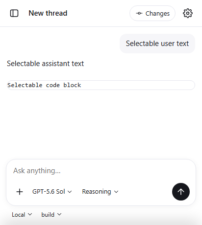

# Пункт 4: Страница не растягивается в WebView

## Проблема

В мобильном WebView протяжка пальцем (pull-to-refresh / bounce) могла вызывать растяжение страницы и скролл всего viewport, жесты зума нарушали вёрстку, системная клавиатура могла перекрывать композер ввода, а тапы сопровождались подсветкой и случайным выделением элементов интерфейса при лонгтапах.

## Реализация

### 1. Kotlin (`MainActivity.kt` и `AndroidManifest.xml`)
- `wv.overScrollMode = View.OVER_SCROLL_NEVER`: отключён эффект растяжения/bounce на уровне нативного WebView.
- Отключён зум:
  ```kotlin
  setSupportZoom(false)
  builtInZoomControls = false
  displayZoomControls = false
  ```
- Режим клавиатуры `adjustResize`:
  - `android:windowSoftInputMode="adjustResize"` в `AndroidManifest.xml`.
  - `window.setSoftInputMode(android.view.WindowManager.LayoutParams.SOFT_INPUT_ADJUST_RESIZE)` в `MainActivity.onCreate`.

### 2. CSS (`codex.html`)
- **Высота и запрет прокрутки окна**:
  - `html, body`: `height: 100%; height: 100dvh; margin: 0; padding: 0; overflow: hidden; overscroll-behavior: none; -webkit-overscroll-behavior: none;`
  - `#app`: `height: 100%; height: 100dvh; display: flex; flex-direction: column; overflow: hidden; overscroll-behavior: none;`
- **Прокрутка строго внутри целевых контейнеров**:
  - Лента (`main`), боковая панель (`.drawer-projects`), шторки (`#sheet`), предпросмотр патчей (`.change-preview`):
    `overflow-y: auto; overscroll-behavior: contain; -webkit-overflow-scrolling: touch;`
- **Запрет масштабирования viewport**:
  - `<meta name="viewport" content="width=device-width,initial-scale=1,maximum-scale=1,user-scalable=no,viewport-fit=cover">`
- **Текстовое выделение**:
  - Для интерфейса: `user-select: none; -webkit-user-select: none;` на корневом уровне `*`. Кнопки, тулбары, иконки и чипы не выделяются при лонгтапах.
  - Для текста сообщений, кода и полей ввода сохранено полноценное выделение:
    `.msg, .msg *, pre, code, .dl, input, textarea, [contenteditable="true"] { user-select: text; -webkit-user-select: text; }`
- **Отключение подсветки тапов**:
  - `-webkit-tap-highlight-color: transparent` для всех элементов и кнопок.

---

## Проверки на настоящем окружении

Запуск `python tests/webview_layout_proof.py`: **8/8 PASS**, `pageErrors: []`.

1. `manifest_adjust_resize`: манифест содержит `android:windowSoftInputMode="adjustResize"`.
2. `kotlin_overscroll_zoom_and_resize`: проверены `OVER_SCROLL_NEVER`, отключение `setSupportZoom`, `builtInZoomControls`, `displayZoomControls`, вызов `SOFT_INPUT_ADJUST_RESIZE`.
3. `viewport_zoom_disabled`: `maximum-scale=1, user-scalable=no` в теге `<meta name="viewport">`.
4. `css_overflow_and_overscroll_containment`:
   - `html` и `body`: `overflow === "hidden"`, `overscroll-behavior === "none"`.
   - `main`: `overflow-y === "auto"`, `overscroll-behavior === "contain"`.
5. `user_select_ui_none_content_text`:
   - `header`, кнопки, чипы: `user-select === "none"`.
   - Сообщения пользователя, ассистента, блоки кода и textarea: `user-select === "text"`.
6. `tap_highlight_disabled`: `-webkit-tap-highlight-color` равен `rgba(0, 0, 0, 0)`.
7. `composer_visible_with_keyboard_adjust_resize`:
   - При сжатии высоты viewport (эмуляция открытия экранной клавиатуры до 460px) композер остаётся точно прижатым к низу экрана и полностью видимым.
8. `keyboard_composer_screenshot_saved`: скриншот сохранён в `tests/evidence/webview-keyboard-composer.png`.



## Регрессионные тесты

- `python tests/sidebar_proof.py`: **7/7 PASS**, `pageErrors: []`.
- `python tests/reasoning_effort_proof.py`: **7/7 PASS**, `pageErrors: []`.
- `python tests/change_history.py`: **7/7 PASS**, `pageErrors: []`.
- `python tests/mobile_features.py`: **9/9 PASS**, `pageErrors: []`.

## Проверить на телефоне Pixel 6

1. Протяжка пальцем вверх/вниз в ленте, по краям экрана или в боковой панели: страница не пружинит, не растягивается и не запускает перезагрузку.
2. Жест зума двумя пальцами (pinch-to-zoom): страница не масштабируется.
3. Нажатие на поле ввода «Ask anything…»: открывается клавиатура, композер аккуратно поднимается над ней и остаётся полностью видимым.
4. Долгий тап по кнопкам/иконкам: элементы интерфейса не выделяются как текст; при этом текст сообщений модели и код можно свободно выделить и скопировать.
